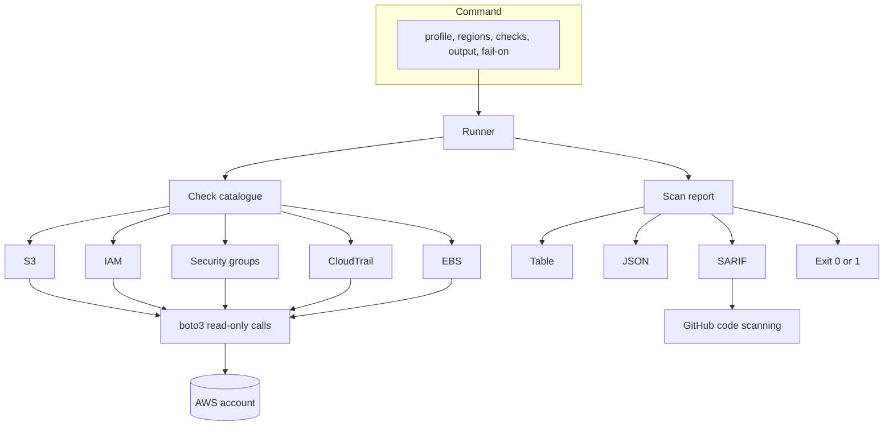

# aws-guardrail-scanner

Read-only scanner for an AWS account. It looks for a short list of common
misconfigurations, prints what it found, and can fail a pipeline when a finding
is serious enough to stop a release.

It is a guardrail, not an audit. Security Hub, GuardDuty, and a human review
still matter. This tool exists so a pipeline can answer a smaller question
quickly: are the controls we already agreed on still in place? A failing check
names the resource and says what to change, which is more useful to an
engineer than a policy document that arrives after the deploy.

Asad Hassan.

The package is not published to PyPI. Install it from a checkout or from this
repository, as shown below. There is no download count and no status badge
here, because there is nothing for one to measure yet.

## What it checks

S3 and IAM are account-wide. Security groups and EBS encryption run once per
Region you name. CloudTrail is asked once, from the first Region, and includes
multi-Region shadow trails.

| Check | Usual severity | What a finding means | Reference |
| --- | --- | --- | --- |
| `s3-account-block-public-access` | medium | Account-level S3 Block Public Access is missing or incomplete | CIS AWS Foundations Benchmark v3.0.0 2.1.4; FSBP S3.1 |
| `s3-bucket-block-public-access` | high, or low if the account guardrail already holds | A bucket is missing one of the four Block Public Access settings | CIS v3.0.0 2.1.4; FSBP S3.8 |
| `s3-public-acl` | critical, or low if public ACLs are ignored | An ACL grants All Users or Authenticated Users access | FSBP S3.2 and S3.3. CIS covers this with 2.1.4 |
| `s3-public-policy` | critical, or low if `RestrictPublicBuckets` is on | `GetBucketPolicyStatus` says the bucket policy is public | FSBP S3.2 and S3.3 |
| `s3-default-encryption` | low | No explicit SSE-S3, SSE-KMS, or DSSE-KMS default | No current control. FSBP S3.4 was retired on 20 September 2023 because S3 now applies SSE-S3 by default. This is hygiene, not proof that objects are plaintext |
| `iam-user-mfa` | high | A user has a console password and no MFA device. Users without a login profile are skipped | CIS v3.0.0 1.10; FSBP IAM.5 |
| `iam-root-access-keys` | critical | The account summary says root has access keys | CIS v3.0.0 1.4; FSBP IAM.4 |
| `iam-root-mfa` | critical | The account summary says root has no MFA. Hardware versus virtual is not distinguished, so FSBP IAM.6 is not claimed | CIS v3.0.0 1.5; FSBP IAM.9 |
| `iam-access-key-age` | medium if active, low if inactive | An access key was created more than 90 days ago. A key that is exactly 90 days old still passes | CIS v3.0.0 1.14; FSBP IAM.3 |
| `ec2-sg-ssh-open` | high | Ingress from `0.0.0.0/0` or `::/0` to port 22 | CIS v3.0.0 5.2 and 5.3; FSBP EC2.13, EC2.53, EC2.54 |
| `ec2-sg-rdp-open` | high | The same, for port 3389 | CIS v3.0.0 5.2 and 5.3; FSBP EC2.14, EC2.53, EC2.54 |
| `ec2-sg-all-ports-open` | critical | Ingress from the whole internet to every port | FSBP EC2.19. CIS has no separate all-ports control |
| `ec2-default-security-group` | high | A VPC default security group still has inbound or outbound rules | CIS v3.0.0 5.4; FSBP EC2.2 |
| `cloudtrail-multi-region` | high | No trail is multi-Region, logging, including global service events, and recording read and write management events | CIS v3.0.0 3.1; FSBP CloudTrail.1 |
| `ec2-ebs-default-encryption` | medium | New EBS volumes in that Region are not encrypted by default. Existing volumes are not inspected | CIS v3.0.0 2.2.1; FSBP EC2.7 |

FSBP means the AWS Foundational Security Best Practices standard in Security Hub CSPM.
Severities are this tool's rating. They follow the spirit of those controls, and
they drop when a guardrail already contains the exposure. A public ACL behind
`IgnorePublicAcls` is still reported, at low, so it is visible without failing
a `--fail-on high` gate.

## How it is put together



Each check is a small class. It receives a `ScanContext` and returns findings.
The runner records a failed read and carries on, so one denied API does not
hide the rest of the account. Calls go out with a user agent of
`aws-guardrail-scanner/0.1.0`, which makes the scan visible in CloudTrail.
Nothing in the tool calls a write API.

## Quickstart

Python 3.12 and credentials that can assume the read-only role below.
`boto3` uses the normal credential chain: a profile, environment variables,
or a role on the runner.

From a checkout:

```bash
pipx install .
aws-guardrail-scanner --region eu-west-1 --fail-on high
```

From this repository, once the commit you want is on the default branch:

```bash
pipx install "git+https://github.com/asadyare/aws-guardrail-scanner.git"
```

Or with Docker, building the image yourself. It is not in a public registry.
The base image is pinned by digest. The build upgrades Debian packages so
known fixed OS issues are not shipped; those package versions are not pinned.

```bash
docker build --tag aws-guardrail-scanner .
docker run --rm \
  -e AWS_ACCESS_KEY_ID \
  -e AWS_SECRET_ACCESS_KEY \
  -e AWS_SESSION_TOKEN \
  aws-guardrail-scanner --region eu-west-1 --output json --fail-on high
```

The container runs as `scanner` (uid 10001), not root.

If you omit `--region`, the profile or `AWS_DEFAULT_REGION` is used. The tool
does not guess `us-east-1`. Pass several Regions with repeated `--region` or
with `--regions eu-west-1,eu-west-2`.

```bash
aws-guardrail-scanner --list-checks
aws-guardrail-scanner --profile security --region eu-west-1 --checks s3,iam --output json
aws-guardrail-scanner --region eu-west-1 --output sarif --fail-on high > results.sarif
```

`--checks` takes ids or prefixes: `s3` runs every S3 check, `ec2-sg` runs the
three world-ingress checks.

Exit codes:

| Code | Meaning |
| --- | --- |
| 0 | The scan finished, and nothing met `--fail-on` |
| 1 | A finding is at or above `--fail-on` |
| 2 | The command was wrong, the profile was missing, or AWS could not be asked who the caller is |

Without `--fail-on`, findings are printed and the process exits 0. That is
deliberate, so a first run cannot break a pipeline by surprise. A read error
is printed on stderr and included in the report. It does not by itself change
the exit code.

## Example output

This is a real run against [moto](https://github.com/getmoto/moto), not a
production account. The account id `123456789012` is moto's. The security
group id is whatever moto assigned in that run. The command was:

```bash
aws-guardrail-scanner \
  --region eu-west-1 \
  --checks s3-public-acl,iam-user-mfa,ec2-sg-ssh-open \
  --output table \
  --fail-on high
```

It exited 1.

```text
Account: 123456789012
Regions: eu-west-1
Checks:  s3-public-acl, iam-user-mfa, ec2-sg-ssh-open

SEVERITY  CHECK            REGION     RESOURCE
--------  ---------------  ---------  ----------------------------------------------------------------------
critical  s3-public-acl    eu-west-1  arn:aws:s3:::customer-uploads
high      ec2-sg-ssh-open  eu-west-1  arn:aws:ec2:eu-west-1:123456789012:security-group/sg-aca65a39ce3e74e67
high      iam-user-mfa     global     arn:aws:iam::123456789012:user/alex

[critical] S3 bucket ACL grants public access
  Resource:    arn:aws:s3:::customer-uploads
  Region:      eu-west-1
  Description: The ACL on customer-uploads grants READ to All Users or Authenticated Users. Block Public Access is not ignoring public ACLs, so the grant is effective.
  Remediation: Remove the All Users and Authenticated Users grants. Prefer Bucket owner enforced (ACLs disabled) and grant access with IAM. Keep IgnorePublicAcls enabled at the account.
  Reference:   AWS Foundational Security Best Practices S3.2 (public read) and S3.3 (public write). CIS AWS Foundations Benchmark v3.0.0 addresses this through control 2.1.4 (Block Public Access) rather than a separate ACL control

[high] Security group allows SSH from the internet
  Resource:    arn:aws:ec2:eu-west-1:123456789012:security-group/sg-aca65a39ce3e74e67
  Region:      eu-west-1
  Description: Security group sg-aca65a39ce3e74e67 (bastion) allows tcp port 22 from 0.0.0.0/0. Managed prefix lists are not expanded, so a prefix list that contains a world CIDR is not detected.
  Remediation: Delete the inbound rule or replace the source with a known CIDR, a security group, or a prefix list that is not the whole internet. Administration ports should be reached through a bastion, VPN, or SSM Session Manager rather than a public listener.
  Reference:   CIS AWS Foundations Benchmark v3.0.0 controls 5.2 (IPv4) and 5.3 (IPv6); AWS Foundational Security Best Practices EC2.13, EC2.53, and EC2.54

[high] IAM user with a console password has no MFA
  Resource:    arn:aws:iam::123456789012:user/alex
  Region:      global
  Description: alex has a console password and no MFA device. A phished or reused password is then enough to open the console.
  Remediation: Register a virtual or hardware MFA device for this user before the next console sign-in. If the user does not need the console, delete the login profile instead of adding MFA to an unused password.
  Reference:   CIS AWS Foundations Benchmark v3.0.0 control 1.10; AWS Foundational Security Best Practices IAM.5

Summary: critical=1, high=2, medium=0, low=0, info=0
```

`--output json` prints the same report as JSON on stdout (`report_version` 1).
`--output sarif` prints [SARIF 2.1.0](https://sarifweb.azurewebsites.net/).
Each result has a `ruleId`, a `security-severity`, a logical location for the
ARN, and a relative artefact URI such as `aws/s3/customer-uploads`. GitHub
code scanning wants a relative path, and these findings are not lines of
source.

## IAM policy

The role that runs the scanner should allow the actions in
[`iam/scanner-policy.json`](iam/scanner-policy.json) and nothing else. A test
fails if that file drifts from the calls in the code. Every action is a
`Get`, `List`, or `Describe`. `Resource` is `*` because these account-level
reads do not all support a resource ARN. That is as narrow as the APIs allow,
not a wildcard permission to the account.

```json
{
  "Version": "2012-10-17",
  "Statement": [
    {
      "Sid": "GuardrailScannerReadOnly",
      "Effect": "Allow",
      "Action": [
        "cloudtrail:DescribeTrails",
        "cloudtrail:GetEventSelectors",
        "cloudtrail:GetTrailStatus",
        "ec2:DescribeSecurityGroups",
        "ec2:GetEbsEncryptionByDefault",
        "iam:GetAccountSummary",
        "iam:GetLoginProfile",
        "iam:ListAccessKeys",
        "iam:ListMFADevices",
        "iam:ListUsers",
        "s3:GetAccountPublicAccessBlock",
        "s3:GetBucketAcl",
        "s3:GetBucketEncryption",
        "s3:GetBucketLocation",
        "s3:GetBucketPolicyStatus",
        "s3:GetBucketPublicAccessBlock",
        "s3:ListAllMyBuckets",
        "sts:GetCallerIdentity"
      ],
      "Resource": "*"
    }
  ]
}
```

If you would rather not maintain a custom policy, attach the AWS managed
policy `SecurityAudit` instead. It covers these reads and a lot more. Prefer
the custom policy on a CI role, where the blast radius should stay small, and
`SecurityAudit` when you want the same role to keep working as checks are
added. Do not add write actions. The scanner does not need them, and a
compromised pipeline should not be able to change the account.

The trust policy depends on who runs it. For GitHub Actions, use OIDC
(`sts:AssumeRoleWithWebIdentity`) and restrict the subject to the repository
and the workflow. This repository does not ship a trust policy, because the
account id and the audience would be yours, not mine.

## Using it as a CI gate

This repository's own workflow does not scan an AWS account. It lints, type
checks, and tests the tool, then scans the image. The workflow below is what
you would add to a repository that is allowed to look at an account. Replace
the role ARN. Code scanning upload needs `security-events: write`, and on a
private repository it needs GitHub code scanning to be enabled.

```yaml
permissions:
  contents: read
  id-token: write
  security-events: write

steps:
  - uses: actions/checkout@3d3c42e5aac5ba805825da76410c181273ba90b1 # v7.0.1
  - uses: aws-actions/configure-aws-credentials@e1253824e5c10ff9df46874f81ed3ec929e19cfd # v6.3.0
    with:
      role-to-assume: arn:aws:iam::123456789012:role/guardrail-scanner
      aws-region: eu-west-1
  - uses: actions/setup-python@6d4fd22b20465ccc0f7354476588e8df7c9ca0e0 # v7.1.0
    with:
      python-version: "3.12"
  - run: python -m pip install .
  - run: aws-guardrail-scanner --region eu-west-1 --output sarif --fail-on high > results.sarif
  - uses: github/codeql-action/upload-sarif@0fda7a646fd14a20daf520829ca1ae8847000819 # codeql-bundle-v2.27.3
    if: always()
    with:
      sarif_file: results.sarif
      category: aws-guardrail-scanner
```

`--fail-on high` fails the job on high and critical findings. Medium and low
still appear in the SARIF file. `if: always()` uploads that file even when
the gate fails, so the annotations are visible on the pull request.

## Development

```bash
python3 -m venv .venv
source .venv/bin/activate
pip install -e ".[dev]"
ruff check .
ruff format --check .
mypy
pytest
bandit -c pyproject.toml -r src
pip-audit --progress-spinner=off
```

Tests use moto. They do not call AWS. `pytest` fails the run under 80%
coverage; the suite currently sits above that. `pip-audit` skips this package
itself, because it is not on PyPI, and audits the dependencies that are.

Continuous integration on pull requests runs Ruff, mypy, pytest, Bandit,
pip-audit, and Trivy (`CRITICAL` and `HIGH`, unfixed issues ignored) against
the image. Actions are pinned to full commit SHAs. The workflow token can
read the repository and nothing else. Dependabot is configured for pip,
GitHub Actions, and Docker, with a cooldown so a release is not opened the
hour it is published.

## Limits

- One account, and only the Regions you name. There is no organisation loop
  and no `AssumeRole` into member accounts.
- Managed prefix lists on security groups are not expanded. A prefix list
  that contains `0.0.0.0/0` will not be reported.
- CloudTrail log-file validation and the access logging of the log bucket
  are not checked. A trail passes when it is multi-Region, logging, includes
  global service events, and records read and write management events.
- Root hardware MFA (FSBP IAM.6) cannot be judged from `GetAccountSummary`.
- S3 objects are not listed. Encryption and public access are configuration
  checks, not a search of object ACLs.
- A denied API becomes an error in the report, not a passing control and not
  a finding.

## Roadmap

These are not built. They are the next pieces that would make the scanner
useful beyond a single account and a pull request.

- GCP, with the same check interface pointed at Cloud Asset or the Google
  API client, so one report can cover both clouds.
- Opt-in remediation through Lambda and EventBridge. A finding would publish
  an event, and a separate function would apply a change that a human has
  already approved. The scanner itself should stay read-only.
- Security Hub ASFF output, so findings can be imported with
  `BatchImportFindings` and sit next to the FSBP controls they relate to.
- Assume-role across an organisation, with an explicit account list rather
  than an unbounded walk of every member.

## Licence

[MIT](LICENSE). See [SECURITY.md](SECURITY.md) for how to report a
vulnerability in the tool.
